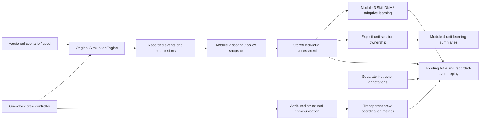

# PRAGYA architecture

## Runtime and boundaries

React/TypeScript/Vite provides a single local application. Zustand holds navigation, selected profile/identity and individual simulation state. One IndexedDB database is authoritative for persisted records; MemoryStorage implements the same typed adapter for tests and explicit temporary fallback. No backend database or runtime cloud API is required. The dependency-free Node launcher exposes built static assets only on loopback.

The original SimulationEngine remains the sole simulation authority. It exposes a trainee projection without answer keys, logs actions on a simulation clock and retains scenario snapshots for review. Module 2 remains the only individual/joint decision-tree scoring engine. Module 3 derives learning from saved assessments. Module 4 adds permission-checked unit relationships, assignments, communication and aggregates rather than manually copied competency scores.

## Data flow

## Main source contracts

| Area | Implementation and contract |
|---|---|
| Simulation | `src/core/sim/engine.ts`, `src/core/types.ts`; canonical event types; schema-1 scenarios; logVersion 1 |
| Individual scoring | `src/core/scoring`; validated policy schema 1, policy ID/version and original saved result |
| Profiles/learning | `src/core/learning`; profile/plan schema 1, evidence references, cohort-separated calculations and `getLearningSnapshot` contractVersion 1 |
| Units/permissions | `src/core/unit`; validated users, units, memberships, instructor scope, cohorts, ownership, assignments and annotations |
| Instructor | `src/core/instructor`; scenario publication, immutable policy versions, snapshot-bound assignments and attributed notes |
| Crew | `src/core/crew`; schema-1 shared record, original engine/log, per-participant events, communication, individual/joint snapshots and separate coordination results |
| Review | `src/core/aar`; actual event prefixes, same-policy/condition comparisons and separate crew annotations |
| Analytics | `src/core/analytics/unitAnalytics.ts`; reportVersion 1; explicit ownership, threshold snapshots, scoped summaries and permitted raw drill-down |
| Transfer | `src/core/transfer/backup.ts`; backupVersion 1, JSON-safe canonical SHA-256, typed references and conflict rejection |

New individual results preserve the selected scoring policy. Instructor assignments capture their scenario/policy at assignment time. Changing a note or creating a new policy version never rewrites an earlier score. Standalone historical import does not assign a unit. A missing policy snapshot prevents equivalence claims.

## Persistence

IndexedDB `pragya-local` version 4 retains scenarios, sessions, settings, trainees and learningPlans, adding a `training` store keyed by `[kind,id]`. Migration does not rewrite or assign old records. All record families remain versioned. Unit-linked profiles are archived rather than deleted. Failed IndexedDB initialization leaves the original database intact and visibly identifies temporary memory use.

Transactions atomically publish scenarios and version metadata, restore backups across stores, and save crew results/profile progression/ownership. Insert-only records protect immutable versions and restoration from overwriting duplicate keys. Per-trainee queues serialize learning writes; crew completion locks both trainee queues in sorted order. Portable crew embeds original assessment snapshots for recovery and validates them against source records; it does not introduce a second scoring authority.

## Crew authority and visibility

A live crew has one original engine and one animation-frame clock. Visual rendering samples that engine without advancing another clock. Participant commits/detections are projected into separate Module 2 assessment streams. Joint detection is tied to the first visible shared observation, with a source communication reference. Coordination metrics remain distinct from individual/joint decision accuracy.

Role projections provide assigned visual or scripted synthetic-indicator information. Turn changes restore the selected person's fields, not another participant's private choice. Structured reports explicitly share their content. Replay shows recorded prefixes; unavailable frames/readings/video are not reconstructed.

A Web Lock grants exclusive local control of a crew ID within one browser profile/origin. Navigation pauses/saves before releasing ownership; a takeover rereads the latest saved prefix. A crashed host releases its lock and unfinished saved state recovers paused. Separate backup copies are independent archives, not synchronized clients. Closed-LAN transport, authenticated host/client protocols and anti-cheat controls are not implemented.

## Permissions and privacy

Service methods validate active membership and designated instructor scope. Trainees access their own record; instructors manage scoped trainees; commanders receive permitted roster summaries/aggregates. Raw individual drill-down additionally requires instructor scope. RoleBoundary prevents restricted views and stale authorized content while identity/profile/screen changes. UI hiding is supplementary to service checks.

This is a cooperative local identity workflow, not hostile-client authentication. Developer tools, OS/browser-profile access and imported files are outside that trust boundary. Backups are private plaintext records with corruption checks, not authenticated/encrypted archives. Separate OS accounts/browser profiles and filesystem controls are deployment assumptions. Static serving exposes no IndexedDB/API endpoint.

## Offline and performance

The build emits a versioned offline shell precaching every application chunk. Same-origin cache lookup handles the preview server's Origin-varying module responses. The console/crew renderer load lazily, reducing the initial entry; the shared 3D chunk remains substantial. No runtime CDN assets or paid inference service is needed. Tests exercise disconnected reload, generation, crew activity, instructor/unit workflows and cross-context backup recovery.

See TEST_REPORT.md for measurements and limitations, and docs/OFFLINE_DEPLOYMENT.md for setup/recovery.

## Synthetic demonstration lifecycle

The lazy-loaded DemoScreen uses `src/core/demo` to assemble an isolated scratch dataset through the original engine, scorer, learning/assignment services and crew runtime. A versioned demo manifest records its unit and original identities. A validated backup appends the new graph atomically; duplicate install is rejected. An imported manifest must bring its own new unit/users/profiles and cannot designate preexisting records as demo data.

Reset previews explicit keys/counts, refuses outside references, extra identities and additional authored unit scenarios, and checks available crew host leases. Both adapters compare all five relevant stores against the approved snapshot before deleting selected keys atomically. IndexedDB reads/comparisons/deletes occur in one readwrite transaction. Settings are excluded from deletion; UI selection falls back when a demo profile is removed. No database-wide clear is used. Scripts and arranged calendar metadata are explicitly synthetic; assessment values are calculated, with original source events preserved.

## Module 5: evidence-qualified training chain

Module 5 extends existing authorities rather than adding a simulation/scoring service:

```mermaid
flowchart LR
  Catalogue[Reviewed objective/version] --> Forge[Original generator + bounded adapter]
  Forge --> Guard[AssessGuard quality/review]
  Guard --> Publication[Atomic scenario/version/candidate]
  Publication --> Assignment[Existing scoped assignment snapshot]
  Assignment --> Engine[Original SimulationEngine]
  Engine --> Ledger[Generated / available / presented / acknowledged / committed]
  Ledger --> Score[Original Module 2 scorer]
  Score --> Judgment[EvidenceMind explanation]
  Score --> Eligibility[Competency-specific eligibility]
  Eligibility --> DNA[Independent Skill DNA / original learning services]
  DNA --> Practice[Guided corrective practice]
  Practice --> Reservation[History-checked answer/evidence variant]
  Reservation --> Engine
  Judgment --> AAR[Existing trainee/instructor AAR]
  DNA --> Progress[Qualified compatible progress / delayed follow-up]
  Progress --> Unit[Explicitly associated unit summaries]
```

`core/groups` adds bounded synthetic group states/projection/report scoring inside the original clock and scorer. Per-contact results and group completeness/attribution/qualification remain distinct. State/presentation/observation/report events support event-prefix replay.

`core/assessGuard` owns optional trainingContract schema 1, blueprints, opportunity schemas, quality linting, deterministic controlled participants, exact-version review and pure eligibility projections. The engine owns canonical events. React text paragraphs emit presentation provenance only after visibility/intersection/frame checks. Generated, available, presented and acknowledged are separate; no historical event is backfilled. Review records contain unit/author, exact scenario key, policy snapshot, passed checks, explicit warning waivers and reasons. Hard integrity errors cannot be waived.

`core/curriculum` owns versioned objective/candidate records, bounded original-generator demand adapters and scoped coverage. The existing instructor publication transaction writes scenario/version/candidate atomically. Assignment writes candidate/assignment links atomically. Objectives cannot be silently edited at the same version. Prerequisites use eligible independent exact-version/score history or an explicit attributable override that retains insufficient-evidence status.

`core/evidenceMind` adds typed explanations over canonical contact results and events. Correctness, sufficiency, relevance, explicit contradictions, uncertainty and reporting are distinct. It does not produce a replacement overall score. Feedback distinguishes unestablished inputs from available-but-unreferenced information, and pre-decision sources from later explanations. Original scores remain immutable.

The original learning adapter now declares stages for new exercises, captures policies and checks immutable completion snapshots. Guided results remain in history but are excluded from independent DNA/trends. Evaluation families exclude seeds, IDs and incidental coordinates; reservation and launch checks compare actual answer/evidence structure with prior attempts/prepared variants. Qualified comparisons require sufficient eligible baseline history, compatible objective/version, full policy, contact count, reporting mode and observation conditions. No compatible evidence means no delta. Retention follow-up observes the profile interval. Old plans remain readable with explicitly unknown assistance/familiarity metadata.

Persistence stays at IndexedDB version 4 with its existing five stores and generic training records. New metadata is optional and schema-versioned; no destructive migration or reset is introduced. `learning/planIntegrity.ts` shares source/stage/reservation/completed-snapshot checks between profile imports and complete backups. SHA-256 checks corruption only. Insert-only restores reject conflicts before atomic writes. Local role checks remain cooperative browser workflows, not a trusted authentication boundary.

The expanded demo is assembled in scratch storage through real curriculum/review/assignment/engine/scoring/learning services, validated, then appended atomically. Its manifest identifies generated scenarios and an exact authored-document snapshot. Reset removes those original demo records only if no outside references, extra identities, edited/additional authored work, active crew host or concurrent-store changes are present. Original Module 4 manifests remain readable; reinstall the demo to obtain Module 5 examples.

Secondary instructor, review, transfer and analytics views are lazy-loaded; the service worker precaches their built resources for prepared offline use. No hosted model, external database, runtime CDN or telemetry service is introduced.

## Product presentation layer (visual overhaul)

`ui/AppShell.tsx` wraps existing lazy routes and RoleBoundary with grouped navigation, local identity context and offline status. Its role-aware visibility supplements the existing service authorization. `HomeScreen` queries authorized real records; absent history is an explicit empty state. WorkspacePrimitives, product.css and existing Tailwind tokens provide shared form, metric, workflow, table, focus and status treatments across the five modules. No database version, recorded assessment or event schema changes are introduced.

`render/SimScene.tsx` owns one R3F Canvas with fixed-world bounded controls. Contacts uses only TraineeView positions/headings/descriptors/appearance. Cosmetic motion uses supplied simTime; it neither advances the engine nor interpolates canonical trajectories. Environment delegates static authored decoration to UrbanDistrict/RuralLandscape and instanced WorldBatch families. `render/quality.ts` centralizes solo/crew DPR and terrain/particle budgets. Directional shadows cover static scenery only and can be cached until environment/lighting/quality changes. Renderer diagnostics are local canvas attributes for browser QA, not a telemetry service. Canonical fog density and observation availability remain unchanged.

SimClockDriver and the existing single-host crew runtime retain their original clock ownership. Canonical engine, scorer, learning qualification and store sources are unchanged. Final QA repaired a pre-existing demo-only composition blocker: a bounded preflight chooses an existing-generator baseline with one normal channel so it matches the walkthrough's adaptive cohort. The generator and comparison criteria remain authoritative. New camera controls and temporary detail LOD affect presentation only; hidden/ambiguous contacts are not resolved from answer keys. No external model, web font, image, texture, CDN or heavy rendering dependency is added.
