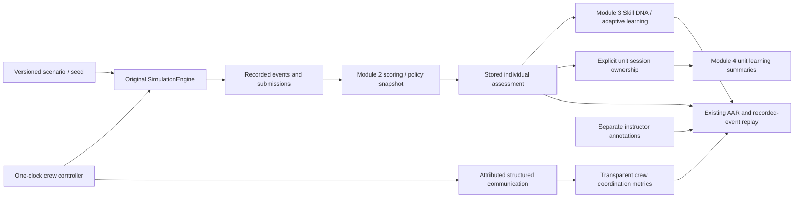

# PRAGYA architecture

## Runtime and boundaries

React/TypeScript/Vite provides a single local application. Zustand holds navigation, selected profile/identity and individual simulation state. One IndexedDB database is authoritative for persisted records; MemoryStorage implements the same typed adapter for tests and explicit temporary fallback. No backend database or runtime cloud API is required. The dependency-free Node launcher exposes built static assets only on loopback.

The original SimulationEngine remains the sole simulation authority. It exposes a trainee projection without answer keys, logs actions on a simulation clock and retains scenario snapshots for review. Module 2 remains the only individual/joint decision-tree scoring engine. Module 3 derives learning from saved assessments. Module 4 adds permission-checked unit relationships, assignments, communication and aggregates rather than manually copied competency scores.

## Data flow

## Main source contracts

| Area | Implementation and contract |
|---|---|
| Simulation | `core/sim/engine.ts`, `core/types.ts`; canonical event types; schema-1 scenarios; logVersion 1 |
| Individual scoring | `core/scoring`; validated policy schema 1, policy ID/version and original saved result |
| Profiles/learning | `core/learning`; profile/plan schema 1, evidence references, cohort-separated calculations and `getLearningSnapshot` contractVersion 1 |
| Units/permissions | `core/unit`; validated users, units, memberships, instructor scope, cohorts, ownership, assignments and annotations |
| Instructor | `core/instructor`; scenario publication, immutable policy versions, snapshot-bound assignments and attributed notes |
| Crew | `core/crew`; schema-1 shared record, original engine/log, per-participant events, communication, individual/joint snapshots and separate coordination results |
| Review | `core/aar`; actual event prefixes, same-policy/condition comparisons and separate crew annotations |
| Analytics | `core/analytics/unitAnalytics.ts`; reportVersion 1; explicit ownership, threshold snapshots, scoped summaries and permitted raw drill-down |
| Transfer | `core/transfer/backup.ts`; backupVersion 1, JSON-safe canonical SHA-256, typed references and conflict rejection |

New individual results preserve the selected scoring policy. Instructor assignments capture their scenario/policy at assignment time. Changing a note or creating a new policy version never rewrites an earlier score. Standalone historical import does not assign a unit. A missing policy snapshot prevents equivalence claims.

## Persistence

IndexedDB `pragya-local` version 4 retains scenarios, sessions, settings, trainees and learningPlans, adding a `training` store keyed by `[kind,id]`. Migration does not rewrite or assign old records. All record families remain versioned. Unit-linked profiles are archived rather than deleted. Failed IndexedDB initialization leaves the original database intact and visibly identifies temporary memory use.

Transactions atomically publish scenarios and version metadata, restore backups across stores, and save crew results/profile progression/ownership. Insert-only records protect immutable versions and restoration from overwriting duplicate keys. Per-trainee queues serialize learning writes; crew completion locks both trainee queues in sorted order. Portable crew embeds original assessment snapshots for recovery and validates them against source records; it does not introduce a second scoring authority.

## Crew authority and visibility

A live crew has one original engine and one animation-frame clock. Visual rendering samples that engine without advancing another clock. Participant commits/detections are projected into separate Module 2 assessment streams. Joint detection is tied to the first visible shared observation, with a source communication reference. Coordination metrics remain distinct from individual/joint decision accuracy.

Role projections provide assigned visual or scripted synthetic-indicator information. Turn changes restore the selected person's fields, not another participant's private choice. Structured reports explicitly share their content. Replay shows recorded prefixes; unavailable frames/readings/video are not reconstructed.

A Web Lock grants exclusive local control of a crew ID within one browser profile/origin. Navigation pauses/saves before releasing ownership; a takeover rereads the latest saved prefix. A crashed host releases its lock and unfinished saved state recovers paused. Separate backup copies are independent archives, not synchronized clients. Closed-LAN transport, authenticated host/client protocols and anti-cheat controls are not implemented.

## Permissions and privacy

Service methods validate active membership and designated instructor scope. Trainees access their own record; instructors manage scoped trainees; commanders receive permitted roster summaries/aggregates. Raw individual drill-down additionally requires instructor scope. RoleBoundary prevents restricted views and stale authorized content while identity/profile/screen changes. UI hiding is supplementary to service checks.

This is a cooperative local identity workflow, not hostile-client authentication. Developer tools, OS/browser-profile access and imported files are outside that trust boundary. Backups are private plaintext records with corruption checks, not authenticated/encrypted archives. Separate OS accounts/browser profiles and filesystem controls are deployment assumptions. Static serving exposes no IndexedDB/API endpoint.

## Offline and performance

The build emits a versioned offline shell precaching every application chunk. Same-origin cache lookup handles the preview server's Origin-varying module responses. The console/crew renderer load lazily, reducing the initial entry; the shared 3D chunk remains substantial. No runtime CDN assets or paid inference service is needed. Tests exercise disconnected reload, generation, crew activity, instructor/unit workflows and cross-context backup recovery.

See TEST_REPORT.md for measurements and limitations, and docs/OFFLINE_DEPLOYMENT.md for setup/recovery.
